  

<strong>Python developer in progress · Computer Science + AI student</strong> Building useful things, learning in public, and getting a little better with every project.

  
  

## Hey, I'm Dany 👋

I study **Computer Science and AI at the University of Leicester** and build projects with Python. My main interests are Telegram bots, backend development, and understanding how software works under the hood. I'm working towards my first Python developer role.

- **Building:** Telegram bots and small backend projects
- **Learning:** FastAPI, Docker, PostgreSQL, and clean architecture
- **Practising:** Data structures and algorithms with [NeetCode](https://github.com/DanyloTselikov/neetcode-submissions)
- **Based in:** UK

## Tools I use

## Selected work

| Project | What you'll find |
| :--- | :--- |
| 🧩 **[NeetCode submissions](https://github.com/DanyloTselikov/neetcode-submissions)** | My synced Python solutions as I practise data structures and algorithms. |
| 🎮 **[Game Lua](https://github.com/DanyloTselikov/gameLua)** | A 2D LÖVE game with enemies, shooting, pickups, and a combo system. |
| 📚 **[Library app](https://github.com/DanyloTselikov/libapp)** | A Python command-line exercise for managing a small book library. |

I'm also developing a Telegram bot; I'll share it here when it's ready.

## Activity

  

<picture>
  <source media="(prefers-color-scheme: dark)" srcset="https://github.com/DanyloTselikov/DanyloTselikov/raw/refs/heads/output/snake-dark.svg" />
  <source media="(prefers-color-scheme: light)" srcset="https://github.com/DanyloTselikov/DanyloTselikov/raw/refs/heads/output/snake.svg" />
  
</picture>

## Let's connect

Interested in Python, backend work, or a project idea? [Send me an email](mailto:celikovdana951@gmail.com) or explore my [repositories](https://github.com/DanyloTselikov?tab=repositories).
